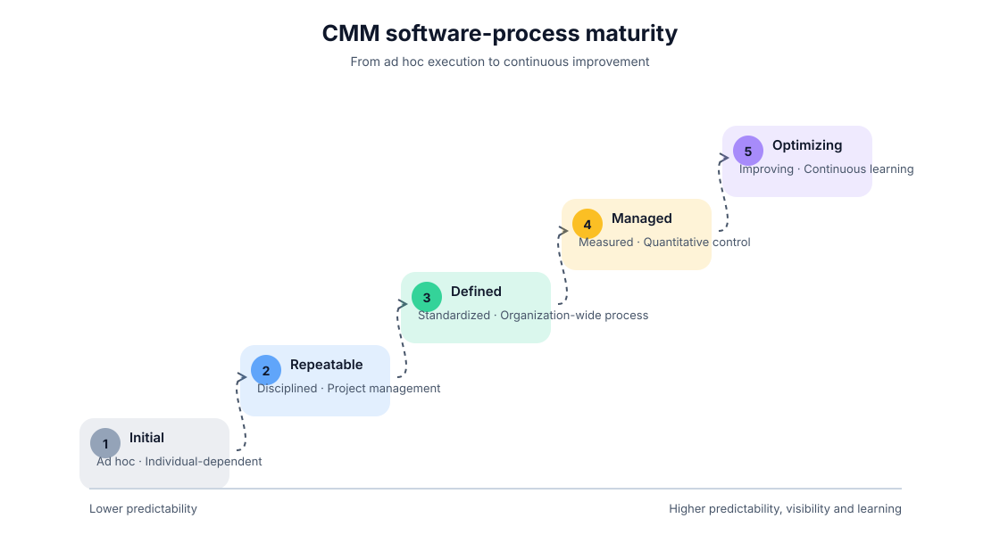
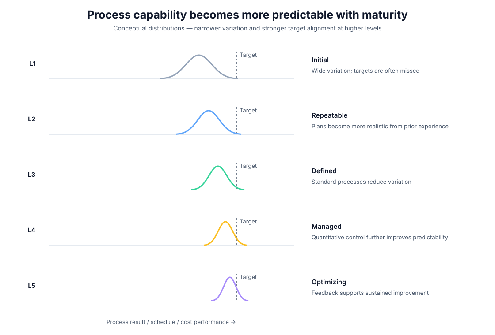
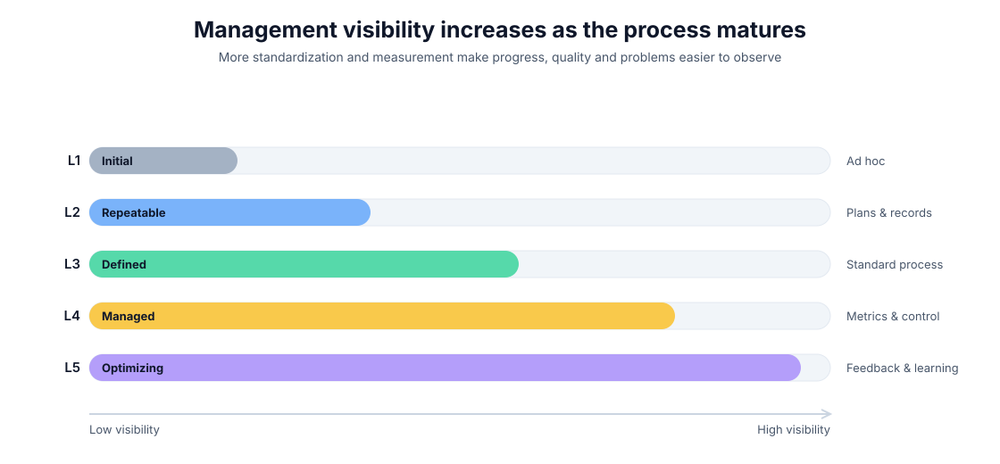

<div align="center">

# Capability Maturity Model (CMM)

**A visual guide to the five levels of software-process maturity**


</div>

---

## Core idea

The Capability Maturity Model (CMM) provides a structured path for improving software-development processes. Its central message is that reliable software engineering depends not only on individual effort, but on processes that become increasingly **repeatable, standardized, measurable, and continuously improvable**.

CMM describes five maturity levels:

<p align="center">
  
</p>

---

## The five maturity levels

| Level | Name | Process character | Main shift |
|---:|---|---|---|
| **1** | **Initial** | Ad hoc and dependent on individuals | Success is unpredictable and often relies on extra effort |
| **2** | **Repeatable** | Basic project-management discipline is introduced | Past successes can be repeated through planning, estimation, and documentation |
| **3** | **Defined** | Processes are standardized across the organization | Teams follow shared methods, training, and documented best practices |
| **4** | **Managed** | Performance is measured quantitatively | Quality, defects, productivity, and process behavior become evidence-based |
| **5** | **Optimizing** | Continuous process improvement is institutionalized | Feedback, learning, and innovation drive proactive improvement |

---

## From unpredictability to process capability

As maturity increases, the process becomes more controlled and predictable. The conceptual distribution below shows the same idea visually: lower levels have wider variability and a greater chance of missing a target; higher levels become tighter around the desired performance region.

<p align="center">
  
</p>

The important idea is **not the exact curve shape**. The visualization represents the qualitative progression described by the model: process performance becomes more predictable as organizations mature.

---

## Process visibility

Higher maturity also improves management visibility. When work is informal and ad hoc, progress and quality are difficult to observe consistently. Standardized processes and quantitative measurement make problems easier to detect earlier and decisions easier to support with evidence.

<p align="center">
  
</p>

This progression changes the management question from reacting to individual problems toward understanding and improving the process that produces the outcomes.

---

## Level-by-level interpretation

### Level 1 — Initial

Work is largely ad hoc. There are few established standards, and outcomes depend heavily on individual capability and last-minute effort. Schedule and quality performance are therefore difficult to predict.

### Level 2 — Repeatable

Basic project-management practices appear. Teams begin to plan, estimate time and cost, document work, and use prior experience to repeat successful approaches.

### Level 3 — Defined

Processes become standardized across the organization. Shared documentation, training, and institutionalized practices create consistency across teams and projects.

### Level 4 — Managed

The organization begins using quantitative measures of performance, defects, productivity, and quality. Decision-making becomes increasingly evidence-based rather than relying only on intuition.

### Level 5 — Optimizing

Continuous improvement becomes part of normal operation. Feedback loops, learning, and new technologies are used proactively to improve the process and prevent recurring problems.

---

## Why the model matters

CMM frames software-process improvement as a **journey rather than a single jump**. Each level adds a capability that supports the next:

```text
Individual effort
      ↓
Repeatable project discipline
      ↓
Organization-wide standardization
      ↓
Quantitative management
      ↓
Continuous improvement
```

The resulting progression is from **chaotic and difficult-to-predict work** toward **disciplined, measurable, visible, and continuously improving engineering processes**.

---

## Practical takeaway

A technically strong team can still struggle when its process is inconsistent. CMM emphasizes that sustainable quality comes from making good practices repeatable, visible, measurable, and improvable across the organization.

---

## Reproducing the diagrams

The three SVG diagrams in `assets/` can be regenerated with:

```bash
python scripts/generate_visuals.py
```

The script uses only the Python standard library and writes vector SVG output, so no extra packages are required.

---

## References

See [`references.md`](references.md) for the sources associated with this concept note.
